# Onboarding flow

Generated by `1state-mermaid` — edit the machine, not this file. Guards print as
written, so a diagram shows every branch, including the ones current answers
would skip.

## `accountEmailAddress`

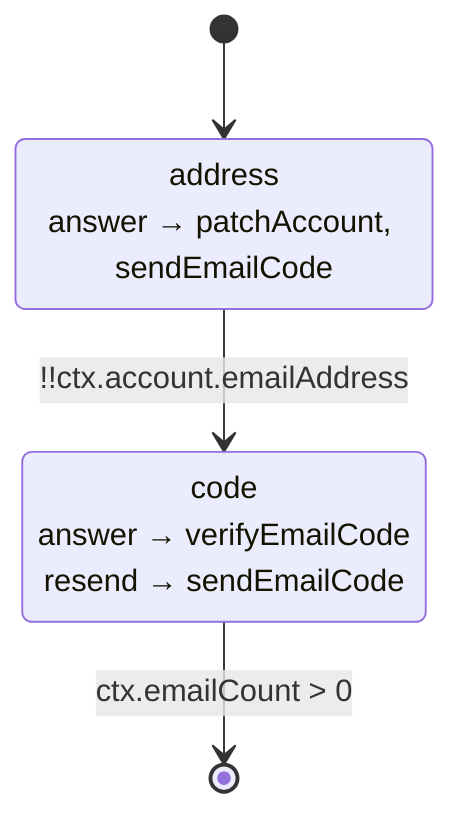

## `accountName`

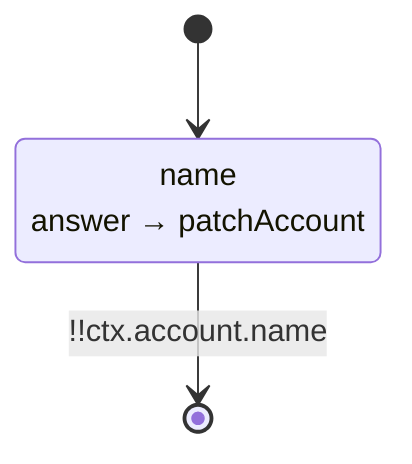

## `accountOnboard`

```mermaid
stateDiagram-v2
  %% accountOnboard
  [*] --> terms
  state "terms<br/>agree → createAccount" as terms
  terms --> username : !!ctx.account.termsAt
  state "username" as username {
    [*] --> username_username
    state "username<br/>answer → patchAccount" as username_username
    username_username --> [*] : !!ctx.account.value
  }
  username --> passkey : done
  state "passkey" as passkey {
    [*] --> passkey_credential
    state "credential<br/>register → addPasskey" as passkey_credential
    passkey_credential --> passkey_name : ctx.passkey.length > 0
    state "name<br/>answer → namePasskey" as passkey_name
    passkey_name --> [*] : ctx.passkey.every((k) => !!k.name)
  }
  passkey --> recoveryCodes : done
  state "recoveryCodes" as recoveryCodes {
    [*] --> recoveryCodes_codes
    state "codes<br/>acknowledge → patchAccount" as recoveryCodes_codes
    recoveryCodes_codes --> [*] : !!ctx.account.recoveryCodesAckedAt
  }
  recoveryCodes --> securityKey : done if ctx.mfaRequire
  recoveryCodes --> name : done
  state "securityKey" as securityKey {
    [*] --> securityKey_credential
    state "credential<br/>register → addSecurityKey" as securityKey_credential
    securityKey_credential --> securityKey_name : ctx.securityKey.length > 0
    state "name<br/>answer → nameSecurityKey" as securityKey_name
    securityKey_name --> [*] : ctx.securityKey.every((k) => !!k.name)
  }
  securityKey --> name : done
  state "name" as name {
    [*] --> name_name
    state "name<br/>answer → patchAccount" as name_name
    name_name --> [*] : !!ctx.account.name
  }
  name --> emailAddress : done
  state "emailAddress" as emailAddress {
    [*] --> emailAddress_address
    state "address<br/>answer → patchAccount, sendEmailCode" as emailAddress_address
    emailAddress_address --> emailAddress_code : !!ctx.account.emailAddress
    state "code<br/>answer → verifyEmailCode<br/>resend → sendEmailCode" as emailAddress_code
    emailAddress_code --> [*] : ctx.emailCount > 0
  }
  emailAddress --> review : done
  state "review<br/>confirm → patchAccount" as review
  review --> invite : !!ctx.account.reviewedAt
  state "invite<br/>answer → patch" as invite
  invite --> [*] : !ctx.invites.length || "inviteAccepted" in ctx
```

## `accountRecoveryCodes`

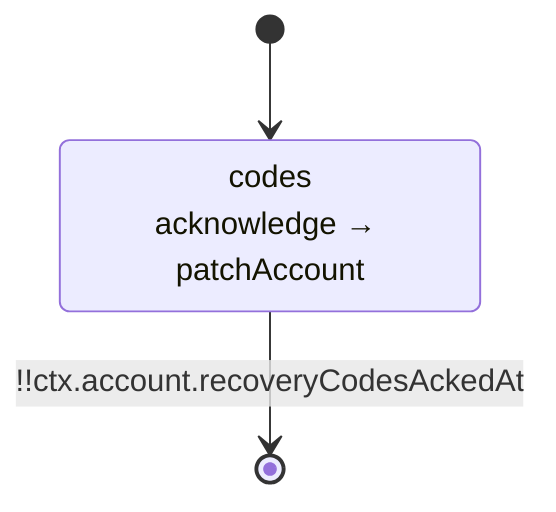

## `accountUsername`

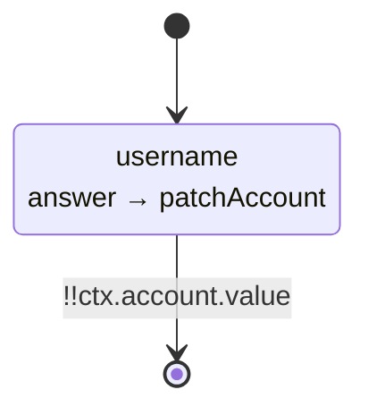

## `accountWebauthnPassKey`

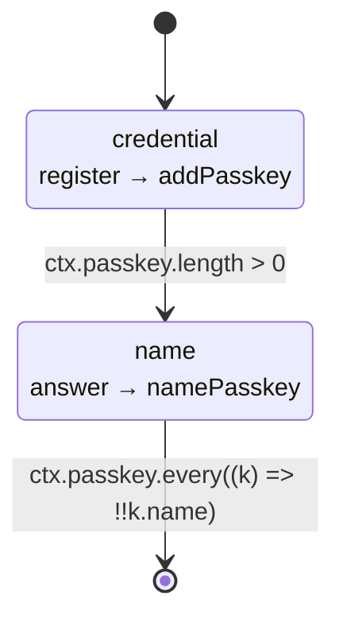

## `accountWebauthnSecurityKey`

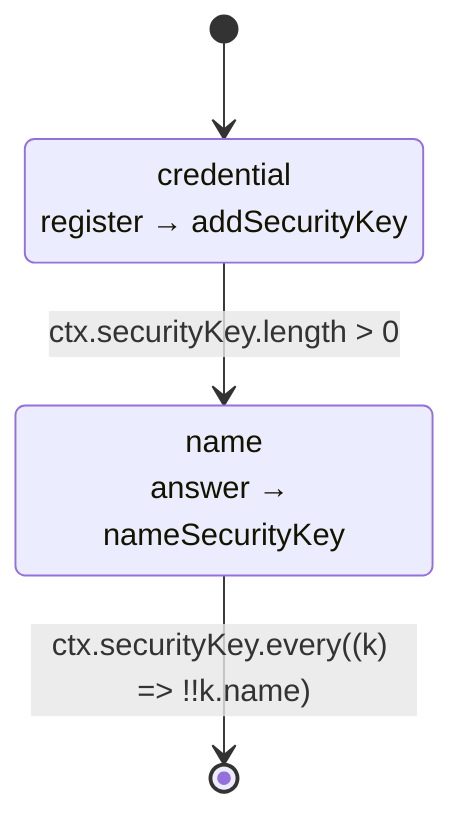

## `domainCaa`

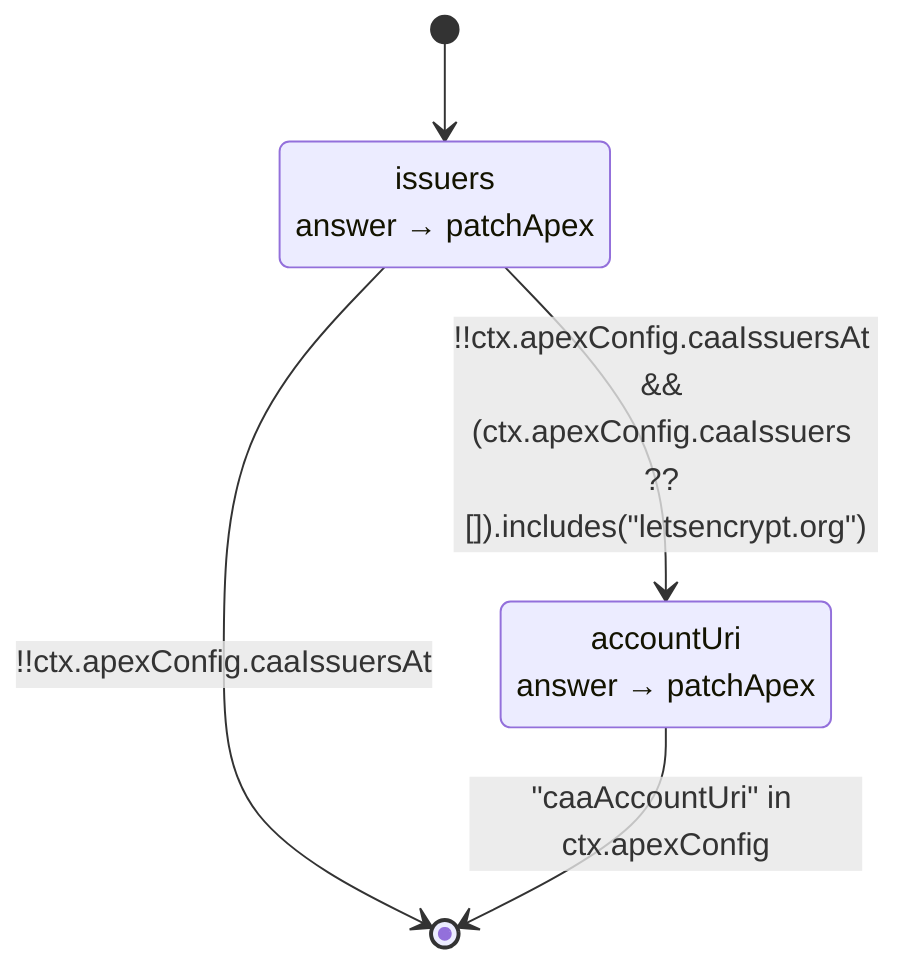

## `domainCrossOriginAssets`

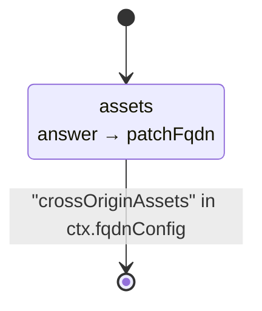

## `domainDeployment`

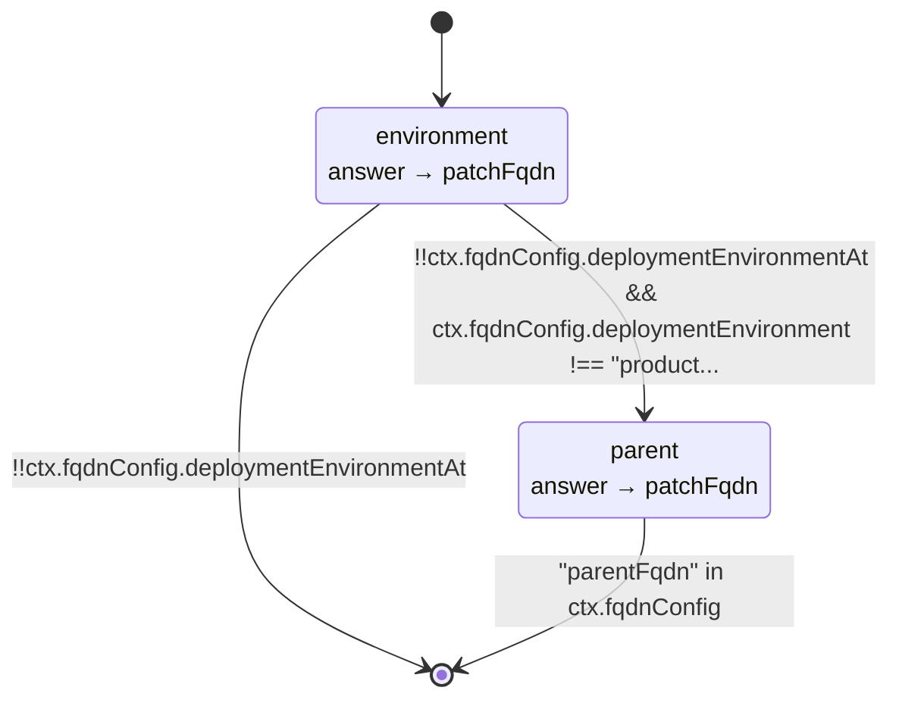

## `domainIntegration`

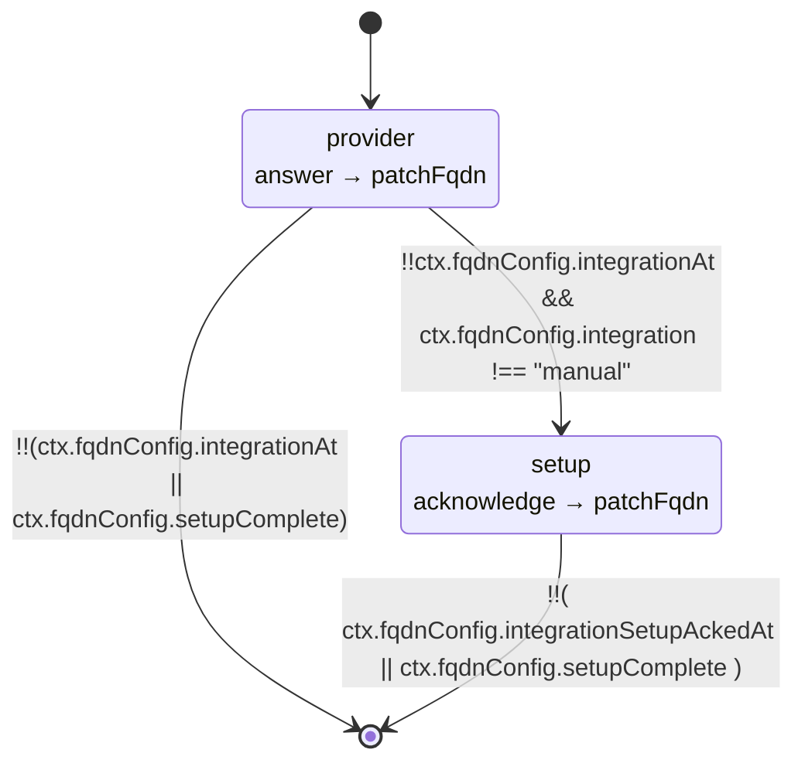

## `domainOnboard`

```mermaid
stateDiagram-v2
  %% domainOnboard
  [*] --> verify
  state "verify" as verify {
    [*] --> verify_verify
    state "verify<br/>request → patchFqdn<br/>observed → patchApex" as verify_verify
    verify_verify --> [*] : [ctx.apexConfig, ctx.fqdnConfig].some( (cfg) => cfg.verifiedDns || cfg.verifiedWellKnown || c...
  }
  verify --> deployment : done
  state "deployment" as deployment {
    [*] --> deployment_environment
    state "environment<br/>answer → patchFqdn" as deployment_environment
    deployment_environment --> deployment_parent : !!ctx.fqdnConfig.deploymentEnvironmentAt && ctx.fqdnConfig.deploymentEnvironment !== "product...
    deployment_environment --> [*] : !!ctx.fqdnConfig.deploymentEnvironmentAt
    state "parent<br/>answer → patchFqdn" as deployment_parent
    deployment_parent --> [*] : "parentFqdn" in ctx.fqdnConfig
  }
  deployment --> caa : done if ctx.network === "clearnet" && !ctx.apexPrivateSuffix && !ctx.parentCaa
  deployment --> upgradeInsecureRequests : done if ctx.network !== "onion"
  deployment --> crossOriginAssets : done
  state "caa" as caa {
    [*] --> caa_issuers
    state "issuers<br/>answer → patchApex" as caa_issuers
    caa_issuers --> caa_accountUri : !!ctx.apexConfig.caaIssuersAt && (ctx.apexConfig.caaIssuers ?? []).includes("letsencrypt.org")
    caa_issuers --> [*] : !!ctx.apexConfig.caaIssuersAt
    state "accountUri<br/>answer → patchApex" as caa_accountUri
    caa_accountUri --> [*] : "caaAccountUri" in ctx.apexConfig
  }
  caa --> upgradeInsecureRequests : done if ctx.network !== "onion"
  caa --> crossOriginAssets : done
  state "upgradeInsecureRequests" as upgradeInsecureRequests {
    [*] --> upgradeInsecureRequests_upgrade
    state "upgrade<br/>answer → patchFqdn" as upgradeInsecureRequests_upgrade
    upgradeInsecureRequests_upgrade --> [*] : "upgradeInsecureRequests" in ctx.fqdnConfig
  }
  upgradeInsecureRequests --> crossOriginAssets : done
  state "crossOriginAssets" as crossOriginAssets {
    [*] --> crossOriginAssets_assets
    state "assets<br/>answer → patchFqdn" as crossOriginAssets_assets
    crossOriginAssets_assets --> [*] : "crossOriginAssets" in ctx.fqdnConfig
  }
  crossOriginAssets --> integration : done
  state "integration" as integration {
    [*] --> integration_provider
    state "provider<br/>answer → patchFqdn" as integration_provider
    integration_provider --> integration_setup : !!ctx.fqdnConfig.integrationAt && ctx.fqdnConfig.integration !== "manual"
    integration_provider --> [*] : !!(ctx.fqdnConfig.integrationAt || ctx.fqdnConfig.setupComplete)
    state "setup<br/>acknowledge → patchFqdn" as integration_setup
    integration_setup --> [*] : !!( ctx.fqdnConfig.integrationSetupAckedAt || ctx.fqdnConfig.setupComplete )
  }
  integration --> review : done
  state "review<br/>confirm → patchFqdn" as review
  review --> reportOnly : !!(ctx.fqdnConfig.reviewedAt || ctx.fqdnConfig.setupComplete)
  state "reportOnly<br/>scan → patchFqdn" as reportOnly
  reportOnly --> [*] : !!ctx.fqdnConfig.setupComplete
```

## `domainUpgradeInsecureRequests`

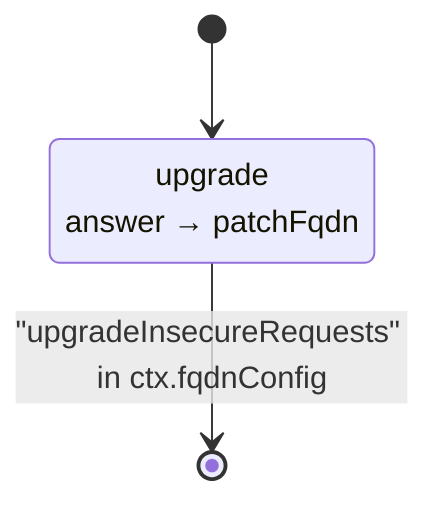

## `domainVerify`

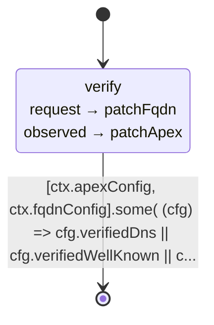

## `onboard`

```mermaid
stateDiagram-v2
  %% onboard
  [*] --> account
  state "account" as account {
    [*] --> account_terms
    state "terms<br/>agree → createAccount" as account_terms
    account_terms --> account_username : !!ctx.account.termsAt
    state "username" as account_username {
      [*] --> account_username_username
      state "username<br/>answer → patchAccount" as account_username_username
      account_username_username --> [*] : !!ctx.account.value
    }
    account_username --> account_passkey : done
    state "passkey" as account_passkey {
      [*] --> account_passkey_credential
      state "credential<br/>register → addPasskey" as account_passkey_credential
      account_passkey_credential --> account_passkey_name : ctx.passkey.length > 0
      state "name<br/>answer → namePasskey" as account_passkey_name
      account_passkey_name --> [*] : ctx.passkey.every((k) => !!k.name)
    }
    account_passkey --> account_recoveryCodes : done
    state "recoveryCodes" as account_recoveryCodes {
      [*] --> account_recoveryCodes_codes
      state "codes<br/>acknowledge → patchAccount" as account_recoveryCodes_codes
      account_recoveryCodes_codes --> [*] : !!ctx.account.recoveryCodesAckedAt
    }
    account_recoveryCodes --> account_securityKey : done if ctx.mfaRequire
    account_recoveryCodes --> account_name : done
    state "securityKey" as account_securityKey {
      [*] --> account_securityKey_credential
      state "credential<br/>register → addSecurityKey" as account_securityKey_credential
      account_securityKey_credential --> account_securityKey_name : ctx.securityKey.length > 0
      state "name<br/>answer → nameSecurityKey" as account_securityKey_name
      account_securityKey_name --> [*] : ctx.securityKey.every((k) => !!k.name)
    }
    account_securityKey --> account_name : done
    state "name" as account_name {
      [*] --> account_name_name
      state "name<br/>answer → patchAccount" as account_name_name
      account_name_name --> [*] : !!ctx.account.name
    }
    account_name --> account_emailAddress : done
    state "emailAddress" as account_emailAddress {
      [*] --> account_emailAddress_address
      state "address<br/>answer → patchAccount, sendEmailCode" as account_emailAddress_address
      account_emailAddress_address --> account_emailAddress_code : !!ctx.account.emailAddress
      state "code<br/>answer → verifyEmailCode<br/>resend → sendEmailCode" as account_emailAddress_code
      account_emailAddress_code --> [*] : ctx.emailCount > 0
    }
    account_emailAddress --> account_review : done
    state "review<br/>confirm → patchAccount" as account_review
    account_review --> account_invite : !!ctx.account.reviewedAt
    state "invite<br/>answer → patch" as account_invite
    account_invite --> [*] : !ctx.invites.length || "inviteAccepted" in ctx
  }
  account --> organizationFork : done
  state "organizationFork<br/>answer → patch" as organizationFork
  organizationFork --> organization : ctx.createOrganization === true
  organizationFork --> domainFork : ctx.createOrganization === false
  state "organization" as organization {
    [*] --> organization_name
    state "name" as organization_name {
      [*] --> organization_name_name
      state "name<br/>answer → patchOrganization" as organization_name_name
      organization_name_name --> [*] : !!ctx.organization.name
    }
    organization_name --> organization_billingEmail : done
    state "billingEmail" as organization_billingEmail {
      [*] --> organization_billingEmail_add
      state "add<br/>add" as organization_billingEmail_add
      organization_billingEmail_add --> organization_billingEmail_review : ctx[key].length >= wanted(ctx)
      state "review<br/>answer<br/>remove" as organization_billingEmail_review
      organization_billingEmail_review --> organization_billingEmail_add : ctx[key].length < wanted(ctx)
      organization_billingEmail_review --> [*] : !!ctx[`${key}At`]
    }
    organization_billingEmail --> organization_promoCode : done
    state "promoCode" as organization_promoCode {
      [*] --> organization_promoCode_required
      state "required<br/>answer" as organization_promoCode_required
      organization_promoCode_required --> organization_promoCode_add : ctx[`${key}Required`] === true
      organization_promoCode_required --> [*] : ctx[`${key}Required`] === false
      state "add<br/>add" as organization_promoCode_add
      organization_promoCode_add --> organization_promoCode_review : ctx[key].length >= wanted(ctx)
      state "review<br/>answer<br/>remove" as organization_promoCode_review
      organization_promoCode_review --> organization_promoCode_add : ctx[key].length < wanted(ctx)
      organization_promoCode_review --> [*] : !!ctx[`${key}At`]
    }
    organization_promoCode --> organization_retention : done
    state "retention" as organization_retention {
      [*] --> organization_retention_retention
      state "retention<br/>answer → patchOrganization" as organization_retention_retention
      organization_retention_retention --> [*] : "retention" in ctx.organization
    }
    organization_retention --> organization_compliance : done
    state "compliance" as organization_compliance {
      [*] --> organization_compliance_compliance
      state "compliance<br/>answer → patchOrganization" as organization_compliance_compliance
      organization_compliance_compliance --> [*] : "compliance" in ctx.organization
    }
    organization_compliance --> organization_collaborator : done
    state "collaborator" as organization_collaborator {
      [*] --> organization_collaborator_required
      state "required<br/>answer" as organization_collaborator_required
      organization_collaborator_required --> organization_collaborator_add : ctx[`${key}Required`] === true
      organization_collaborator_required --> [*] : ctx[`${key}Required`] === false
      state "add<br/>add" as organization_collaborator_add
      organization_collaborator_add --> organization_collaborator_review : ctx[key].length >= wanted(ctx)
      state "review<br/>answer<br/>remove" as organization_collaborator_review
      organization_collaborator_review --> organization_collaborator_add : ctx[key].length < wanted(ctx)
      organization_collaborator_review --> [*] : !!ctx[`${key}At`]
    }
    organization_collaborator --> organization_review : done
    state "review<br/>confirm → patchOrganization" as organization_review
    organization_review --> [*] : !!ctx.organization.reviewedAt
  }
  organization --> domainFork : done
  state "domainFork<br/>answer → patch" as domainFork
  domainFork --> domain : ctx.createDomain === true
  domainFork --> [*] : ctx.createDomain === false
  state "domain" as domain {
    [*] --> domain_verify
    state "verify" as domain_verify {
      [*] --> domain_verify_verify
      state "verify<br/>request → patchFqdn<br/>observed → patchApex" as domain_verify_verify
      domain_verify_verify --> [*] : [ctx.apexConfig, ctx.fqdnConfig].some( (cfg) => cfg.verifiedDns || cfg.verifiedWellKnown || c...
    }
    domain_verify --> domain_deployment : done
    state "deployment" as domain_deployment {
      [*] --> domain_deployment_environment
      state "environment<br/>answer → patchFqdn" as domain_deployment_environment
      domain_deployment_environment --> domain_deployment_parent : !!ctx.fqdnConfig.deploymentEnvironmentAt && ctx.fqdnConfig.deploymentEnvironment !== "product...
      domain_deployment_environment --> [*] : !!ctx.fqdnConfig.deploymentEnvironmentAt
      state "parent<br/>answer → patchFqdn" as domain_deployment_parent
      domain_deployment_parent --> [*] : "parentFqdn" in ctx.fqdnConfig
    }
    domain_deployment --> domain_caa : done if ctx.network === "clearnet" && !ctx.apexPrivateSuffix && !ctx.parentCaa
    domain_deployment --> domain_upgradeInsecureRequests : done if ctx.network !== "onion"
    domain_deployment --> domain_crossOriginAssets : done
    state "caa" as domain_caa {
      [*] --> domain_caa_issuers
      state "issuers<br/>answer → patchApex" as domain_caa_issuers
      domain_caa_issuers --> domain_caa_accountUri : !!ctx.apexConfig.caaIssuersAt && (ctx.apexConfig.caaIssuers ?? []).includes("letsencrypt.org")
      domain_caa_issuers --> [*] : !!ctx.apexConfig.caaIssuersAt
      state "accountUri<br/>answer → patchApex" as domain_caa_accountUri
      domain_caa_accountUri --> [*] : "caaAccountUri" in ctx.apexConfig
    }
    domain_caa --> domain_upgradeInsecureRequests : done if ctx.network !== "onion"
    domain_caa --> domain_crossOriginAssets : done
    state "upgradeInsecureRequests" as domain_upgradeInsecureRequests {
      [*] --> domain_upgradeInsecureRequests_upgrade
      state "upgrade<br/>answer → patchFqdn" as domain_upgradeInsecureRequests_upgrade
      domain_upgradeInsecureRequests_upgrade --> [*] : "upgradeInsecureRequests" in ctx.fqdnConfig
    }
    domain_upgradeInsecureRequests --> domain_crossOriginAssets : done
    state "crossOriginAssets" as domain_crossOriginAssets {
      [*] --> domain_crossOriginAssets_assets
      state "assets<br/>answer → patchFqdn" as domain_crossOriginAssets_assets
      domain_crossOriginAssets_assets --> [*] : "crossOriginAssets" in ctx.fqdnConfig
    }
    domain_crossOriginAssets --> domain_integration : done
    state "integration" as domain_integration {
      [*] --> domain_integration_provider
      state "provider<br/>answer → patchFqdn" as domain_integration_provider
      domain_integration_provider --> domain_integration_setup : !!ctx.fqdnConfig.integrationAt && ctx.fqdnConfig.integration !== "manual"
      domain_integration_provider --> [*] : !!(ctx.fqdnConfig.integrationAt || ctx.fqdnConfig.setupComplete)
      state "setup<br/>acknowledge → patchFqdn" as domain_integration_setup
      domain_integration_setup --> [*] : !!( ctx.fqdnConfig.integrationSetupAckedAt || ctx.fqdnConfig.setupComplete )
    }
    domain_integration --> domain_review : done
    state "review<br/>confirm → patchFqdn" as domain_review
    domain_review --> domain_reportOnly : !!(ctx.fqdnConfig.reviewedAt || ctx.fqdnConfig.setupComplete)
    state "reportOnly<br/>scan → patchFqdn" as domain_reportOnly
    domain_reportOnly --> [*] : !!ctx.fqdnConfig.setupComplete
  }
  domain --> [*] : done
```

## `organizationBillingEmail`

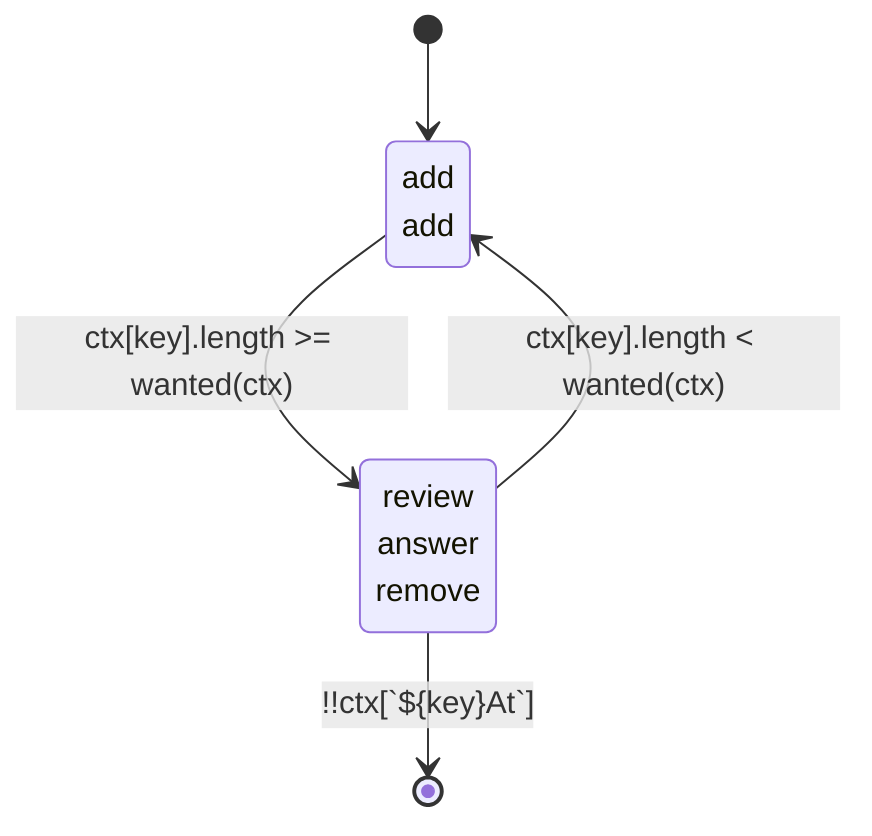

## `organizationCollaborator`

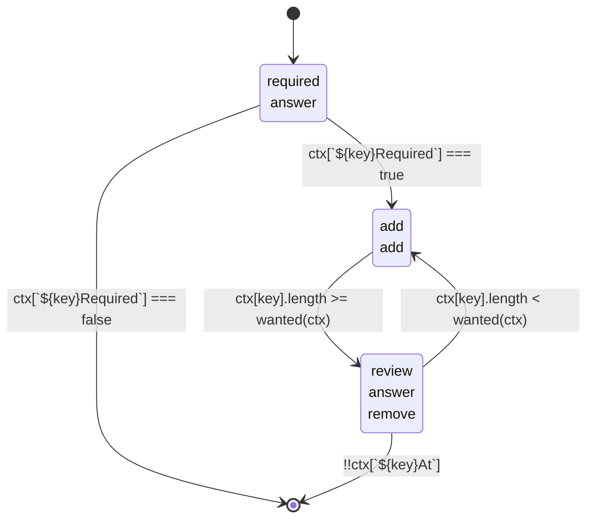

## `organizationCompliance`

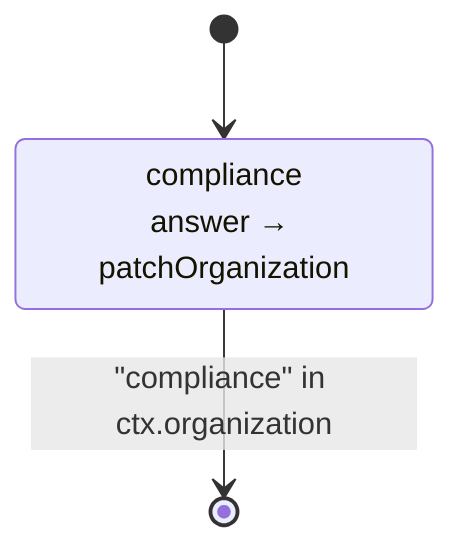

## `organizationName`

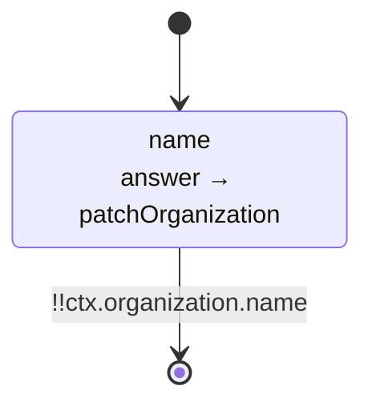

## `organizationOnboard`

```mermaid
stateDiagram-v2
  %% organizationOnboard
  [*] --> name
  state "name" as name {
    [*] --> name_name
    state "name<br/>answer → patchOrganization" as name_name
    name_name --> [*] : !!ctx.organization.name
  }
  name --> billingEmail : done
  state "billingEmail" as billingEmail {
    [*] --> billingEmail_add
    state "add<br/>add" as billingEmail_add
    billingEmail_add --> billingEmail_review : ctx[key].length >= wanted(ctx)
    state "review<br/>answer<br/>remove" as billingEmail_review
    billingEmail_review --> billingEmail_add : ctx[key].length < wanted(ctx)
    billingEmail_review --> [*] : !!ctx[`${key}At`]
  }
  billingEmail --> promoCode : done
  state "promoCode" as promoCode {
    [*] --> promoCode_required
    state "required<br/>answer" as promoCode_required
    promoCode_required --> promoCode_add : ctx[`${key}Required`] === true
    promoCode_required --> [*] : ctx[`${key}Required`] === false
    state "add<br/>add" as promoCode_add
    promoCode_add --> promoCode_review : ctx[key].length >= wanted(ctx)
    state "review<br/>answer<br/>remove" as promoCode_review
    promoCode_review --> promoCode_add : ctx[key].length < wanted(ctx)
    promoCode_review --> [*] : !!ctx[`${key}At`]
  }
  promoCode --> retention : done
  state "retention" as retention {
    [*] --> retention_retention
    state "retention<br/>answer → patchOrganization" as retention_retention
    retention_retention --> [*] : "retention" in ctx.organization
  }
  retention --> compliance : done
  state "compliance" as compliance {
    [*] --> compliance_compliance
    state "compliance<br/>answer → patchOrganization" as compliance_compliance
    compliance_compliance --> [*] : "compliance" in ctx.organization
  }
  compliance --> collaborator : done
  state "collaborator" as collaborator {
    [*] --> collaborator_required
    state "required<br/>answer" as collaborator_required
    collaborator_required --> collaborator_add : ctx[`${key}Required`] === true
    collaborator_required --> [*] : ctx[`${key}Required`] === false
    state "add<br/>add" as collaborator_add
    collaborator_add --> collaborator_review : ctx[key].length >= wanted(ctx)
    state "review<br/>answer<br/>remove" as collaborator_review
    collaborator_review --> collaborator_add : ctx[key].length < wanted(ctx)
    collaborator_review --> [*] : !!ctx[`${key}At`]
  }
  collaborator --> review : done
  state "review<br/>confirm → patchOrganization" as review
  review --> [*] : !!ctx.organization.reviewedAt
```

## `organizationPromoCode`

```mermaid
stateDiagram-v2
  %% organizationPromoCode
  [*] --> required
  state "required<br/>answer" as required
  required --> add : ctx[`${key}Required`] === true
  required --> [*] : ctx[`${key}Required`] === false
  state "add<br/>add" as add
  add --> review : ctx[key].length >= wanted(ctx)
  state "review<br/>answer<br/>remove" as review
  review --> add : ctx[key].length < wanted(ctx)
  review --> [*] : !!ctx[`${key}At`]
```

## `organizationRetention`

```mermaid
stateDiagram-v2
  %% organizationRetention
  [*] --> retention
  state "retention<br/>answer → patchOrganization" as retention
  retention --> [*] : "retention" in ctx.organization
```
